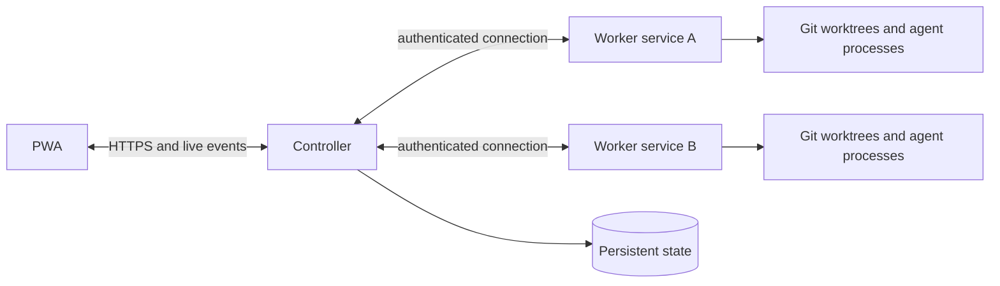

# Architecture plan

This is a proposed first-release design, not a finalized protocol. Validate the runner integrations and failure behavior early, before committing to their detailed contracts.

## Components



The controller serves the PWA, persists projects, conversations, jobs and events, and schedules work. Native macOS and Windows desktop apps configure and start or gracefully stop the worker engine; remote desktop workers establish SSH tunnels to the controller. A worker validates local capabilities, creates and manages worktrees, supervises runner processes, and reports events. The PWA talks only to the controller. Worker execution continues independently of a browser connection.

Use Rust for the controller and worker, with a small shared protocol crate. A Rust async HTTP stack and SQLite are plausible defaults for a single controller; choose libraries after a small prototype and measure idle memory, startup time, event throughput, and behavior under concurrent jobs. SQLite is local durable state, not a shared database between nodes. Build the PWA with a lightweight web stack chosen for accessibility and maintainability; Rust is not required in the browser. Avoid an additional broker or database service until measured needs justify one.

## Core model

- **Project** groups related repositories and conversations. A repository has a stable controller ID and a relative location under a project.
- **Node** is an enrolled worker with a configured projects root, capabilities, connectivity state, and concurrency limit.
- **Conversation** contains ordered user and agent messages and links to jobs. A conversation belongs to one project and repository in the first release.
- **Job** is one requested execution, with runner, repository, base ref, assignment policy, state, timestamps, and references to its worktree and events.
- **Worktree** records its node, path, branch, base commit, lifecycle state, and associated jobs. It remains on its node until explicitly removed.
- **Event** is a persisted, ordered record of a job's output, status, or actionable prompt. Preserve enough information to reconstruct the user-facing history without requiring an open connection.

Use stable identifiers and versioned messages. Persist state transitions transactionally. Do not assume clocks on separate nodes are synchronized for ordering.

## Repository layout and worktrees

Each worker has a configurable projects root, defaulting to `~/projects`. A generic layout is:

```text
~/projects/<project>/<repository>/
~/projects/<project>/.worktrees/<repository>/<worktree-id>/
```

Projects without environment configuration retain manual checkout behavior. Managed projects declare an HTTPS Git source, revision and Native, Container or Hybrid environment. Explicit node assignment authorizes clone/fetch and setup within permissions stored in the node’s desktop app. Validate root and origin, stage missing clones, resolve the selected commit, and prepare a detached worktree. Existing checkout files and branches remain unchanged. Schedule managed work only after successful preparation. See [project environments](project-environments.md) for lifecycle, container/session handling, local policy and recovery. Resolve and validate paths under the configured roots, reject traversal and unsafe symlink escapes, and never derive shell commands by interpolating untrusted strings.

For a new unit of work, the worker resolves the base ref to a commit, creates a unique branch and worktree, records both, then starts the runner inside it. Concurrent jobs get separate worktrees by default. A continuation can reuse the same worktree only when no other job is using it; queue it otherwise. Never run two agents against the same worktree concurrently.

Worktrees survive successful, failed, canceled, and interrupted jobs. Cleanup is explicit: show the node, path, branch, and whether the worktree is dirty; refuse destructive removal of uncommitted changes by default. Removing a worktree must not automatically delete its branch. If the node is offline, retain the cleanup request or report that cleanup cannot yet run. Reconcile recorded worktrees with Git and the filesystem after restart; surface discrepancies rather than silently deleting data.

## Runner adapters

Implement Codex and Claude Code as separate adapters behind a common worker-side interface. Each adapter discovers the installed executable and version, checks its own prerequisites, launches a process in the designated worktree, translates supported output to normalized events, handles cancellation, and records its exit outcome. Keep the raw diagnostic information needed to explain translation failures, subject to the data-handling policy.

The normalized contract should distinguish text, progress, tool activity, errors, final outcome, and any interactive approval or input request. Do not claim equivalent capabilities where the CLIs differ. Prototype each installed CLI's machine-readable streaming, session continuation, permissions, exit codes, cancellation, and version compatibility; document the supported versions and fallback behavior based on actual tests. A runner requiring input must enter a visible waiting state rather than hang invisibly. Do not enable unattended permission escalation implicitly.

The initial conversation can map to a runner session when supported. Persist the runner's session identifier separately from Xenia's conversation ID. If session resume is unsupported, unavailable, or fails, make that clear and require an explicit new execution; do not silently pretend full context was preserved. Subsequent jobs may reuse the existing worktree under the exclusive-use rule above.

## Scheduling and failure recovery

The controller owns the durable queue and chooses among connected nodes that report the requested runner and a usable repository, subject to configured capacity and any explicit node assignment. Start with a predictable FIFO policy for eligible jobs, while allowing a blocked job to be bypassed by another job that can run. Explicitly assigned jobs wait for their chosen node. Show queue position where meaningful and explain blocking reasons.

The worker independently enforces its concurrency limit. Lowering a limit does not terminate running jobs; it prevents new starts until usage falls below the new limit. Worktree creation and runner startup count toward capacity. Assignments require unique attempt IDs and acknowledgments so reconnects or retries cannot start the same attempt twice. Persist assignment and acceptance before reporting them as durable. Define lease and reconciliation behavior in the protocol prototype: a disconnected worker is not proof that its process stopped, so do not automatically start a duplicate elsewhere while its status is uncertain.

Use states such as queued, assigned, starting, running, waiting for input, succeeded, failed, canceled, and interrupted/unknown. The precise transition table and retry policy must be specified and tested. On controller restart, reload durable state and reconcile with reconnecting workers. On worker restart, inspect supervised processes and recorded worktrees where possible; mark uncertain or interrupted work honestly. Cancellation is acknowledged only after the worker confirms the process has stopped; disconnected cancellation remains pending. Preserve output already received and make gaps visible.

## Mobile PWA and event delivery

Design around a small-screen navigation model for conversations, queue, and nodes, with large touch targets, readable streamed output, accessible focus and status announcements, and safe-area support. Desktop can show more context at once. Respect reduced-motion and system color preferences. Validate with keyboard and screen-reader checks, narrow viewports, and real mobile devices where available.

Serve a web app manifest and service worker for installation and caching of static assets. Live updates can use a single authenticated server connection such as WebSocket or server-sent events, selected during prototyping. Persist events before broadcasting, assign monotonically ordered cursors, and allow a reconnecting client to catch up without duplicating visible messages. Bound event buffers and paginate history so long conversations do not grow browser or server memory without limit. When disconnected, show connection state and avoid implying a submitted action succeeded without confirmation.

## Security and privacy

Workers support direct HTTPS with certificate/hostname validation and no redirects.
The native apps initiate five-minute access requests, display a comparison code,
and wait for approval in the Nodes view. The worker generates its credential; the
controller persists only its digest and activates it on authenticated polling
after approval. Pending requests cannot replace enrolled identities. See the
[node enrollment protocol](node-enrollment.md). SSH is optional compatibility
transport, rather than an enrollment requirement.


Phone enrollment uses an operator-created HTTPS link with a random code in its URL fragment. The PWA removes that fragment immediately and exchanges the code through a POST request. SQLite atomically consumes a digest of the code within its two-minute lifetime and issues a separate 30-day operator credential. Device credentials are stored as digests, bound to the current root-token digest, capped at 32, and revocable. The browser retains its device credential in local storage; static service-worker caching excludes the API. QR generation is local Rust/SVG with no external QR service. Pairing supplies the controller address and authentication; private-network/VPN connectivity remains an operating-system prerequisite.

A trusted private network is the deployment assumption, not an identity mechanism. Authenticate PWA users and workers, encrypt connections where practical, and provide a revocable enrollment mechanism. Define credential storage, rotation, and recovery before implementation. Runner credentials stay on their worker; do not send them to the controller. Explicitly document the execution privileges and repository access granted to runners. Enforce supported runner permission modes and expose approval requests where feasible.

Conversation output and repository paths can contain sensitive material. Restrict access to persisted state and logs, avoid logging secrets, and document retention and deletion behavior. Use generic examples and synthetic test data throughout the public repository; do not commit real hostnames, usernames, tokens, personal paths, or conversation transcripts.

## Delivery and validation

1. **Integration spike:** Exercise both CLIs on a worker, including streaming, cancellation, prompts, and resume; record versions, limitations, and memory measurements.
2. **Controller and worker foundation:** Enroll a node, authenticate, reconnect, persist state, and report capabilities. Test invalid credentials and reconnects.
3. **Worktree and single-job vertical slice:** Submit one job from the PWA, create an isolated worktree, stream and persist events, and retain its result. Test setup failure and cancellation.
4. **Scheduling and recovery:** Add multiple nodes, limits, explicit assignment, durable queueing, and reconciliation. Test saturation, disconnects, restarts, duplicate delivery, and exclusive worktree use.
5. **PWA refinement:** Complete mobile navigation, installability, accessibility, reconnect/catch-up, and bounded history rendering. Test on mobile and desktop browsers.
6. **Release preparation:** Define deployment, operational recovery, privacy and retention, supported platforms and runner versions, and release licensing. Review repository contents for personal information and measure idle and active resource use.

The implementation should have unit tests for state transitions and path validation, integration tests with fake runners and disposable Git repositories, and a small set of end-to-end checks with real supported runners. Record baseline memory and CPU under idle and representative concurrent workloads; set budgets once target hardware and measurements are known.
